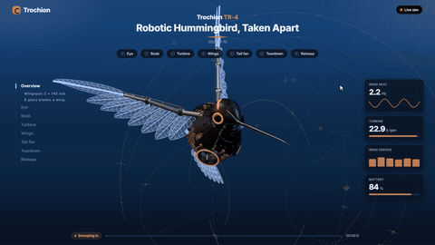
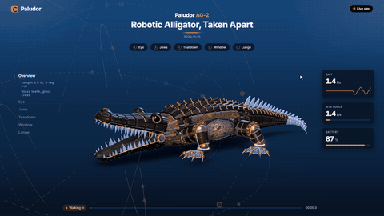
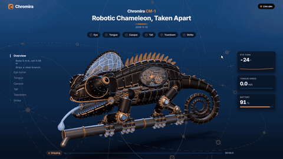

# Blueprint

**By [Neurivex](https://x.com/Neurivex).** A Claude Code skill that takes one reference picture of a machine or a robotic creature, rebuilds it in three.js from code, and films it coming apart piece by piece in a night-studio look.

Dark matte shells, one warm amber accent, cold blueprint light on everything you can see through. Every part is a button: press it and that part opens under its own camera while live cards on the page follow along. The same code renders a 60 fps film with a score built on the same timeline.

## Made with it

Four builds, each from one AI picture, each a 10-second cut rendered frame by frame from code. Click a preview for the full mp4 with sound.

| | |
|---|---|
| [](media/shark.mp4)<br>**Carcharo GW-1** · great white · built on the piranha | [](media/hummingbird.mp4)<br>**Trochion TR-4** · hummingbird · built on the wasp |
| [](media/alligator.mp4)<br>**Paludor AG-2** · alligator · built on the shark | [](media/chameleon.mp4)<br>**Chromira CM-1** · chameleon · built on the alligator |

Each one reuses the closest earlier body, so every new animal starts further along than the last.

**New here? Read the [full guide](docs/GUIDE.md):** setup, the reference sheet, the still, the film, posting, troubleshooting.

## Install

```
npx skills add Denys01/blueprint -g -a claude-code
```

Then once, inside the installed folder:

```
npm install && npx playwright install chromium
```

Node.js 20+. For video you also need `ffmpeg`, for sound Python 3 (standard library only).

## Use it

Give Claude Code a picture and say what you want in plain words:

> Here's a robotic hammerhead. Build it with Blueprint and stop at the still so I can check it.

> The still is approved. Film it like the piranha example, 21 seconds, then a 10-second cut.

No picture yet? `docs/PROMPTS.md` has the reference prompt in the Neurivex look, ready-made subjects, and the reference-sheet prompt that worked best: one sheet with a hero shot, side/top/front/back views and close-ups, split into separate panels for Claude to read. Step by step for ChatGPT, with a worked example: [`docs/REFERENCE_IMAGES.md`](docs/REFERENCE_IMAGES.md).

## The look

| Role | Colour |
|---|---|
| Studio, top to floor | `#154579` → `#0E2A4A` → `#09090A` |
| Shells | matte `#1A1C21` |
| Accent (only what is moving) | amber `#D78453`, glow `#CC774B` |
| Glass, membranes, see-through parts | blueprint `#9CC9FF` |
| Page text | `#EAF4FF` |

All of it lives in `sims/night/look.js` and `sims/night/console.js`. Change those two files and every object follows.

## How a build goes

1. **Picture.** It sets the look only. Claude reads it and rebuilds it, it never imports it.
2. **Numbers off the picture** before any code: proportions and how much fine detail it carries.
3. **A checklist for this picture,** 10 to 12 lines, graded every round.
4. **Still first.** Claude stops after round 2 and waits for you. No film before your yes.
5. **Film** on the choreography of the closest example, with its own camera per part.
6. **A short cut** written as its own script.

The details are in `docs/`.

## Inside

| | |
|---|---|
| `SKILL.md` | What Claude follows: order of work, rules, review loop, commands. |
| `docs/` | The full guide, the brief, the checklist format, all prompts, how to make the reference images in ChatGPT, the lessons log. |
| `sims/night/` | The night look and the page around every object, plus review tools. |
| `sims/kit/` | Runtime, stage, shader warm-up. |
| `sims/<name>-shared/-film/-demo` | Original examples (tarantula, piranha, wasp): the object, the full film, the 10-second cut. |
| `sims/<name>-shared/-still/-demo` | Blueprint builds (shark, robohum, alligator, chameleon): the object with its checklist, the approved still, the 10-second cut. |
| `media/` | Previews of the four Blueprint cuts (GIF for the README, mp4 with sound). |
| `sims/build.mjs` | Bundles an object into one offline HTML file. |
| `sims/capture.mjs` | Renders frames to a 60 fps mp4 or to review sheets. |
| `sfx/`, `run_sfx.py` | Procedural sound on the film's timeline, mastered to −14 LUFS. |

## Credits

(MIT): the tarantula, piranha and wasp examples and the build/review method come from there. The runtime, capture and sound engine come from [whaleyxbt/claude-motion](https://github.com/whaleyxbt/claude-motion) (MIT). Recorded samples are CC0 from Freesound, prepared by [Barty-Bart/motion-graphics](https://github.com/Barty-Bart/motion-graphics); sources in `sfx/samples/SOURCES.md`.

What's new in Blueprint: the night look (palette, lighting, dark page), a detail-based density check that works on dark shells, a `keep` flag so bright steel and brass survive the night retint, the `blueprint-kit` / `blueprint-night` import names, new reference prompts, and four new builds (great white, hummingbird, alligator, chameleon) with their corrections logged in `docs/`.

MIT licence.
