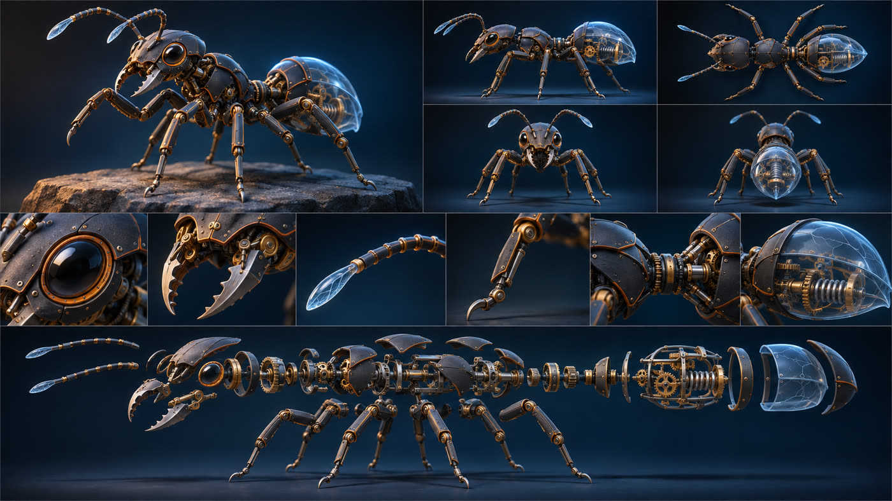
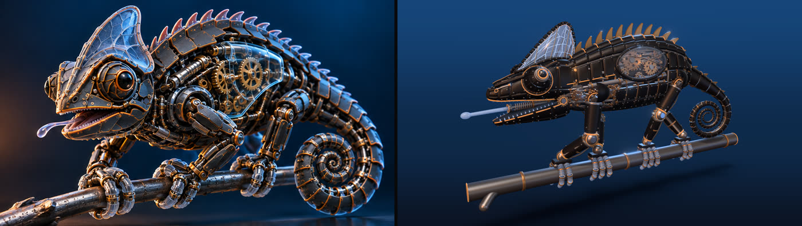
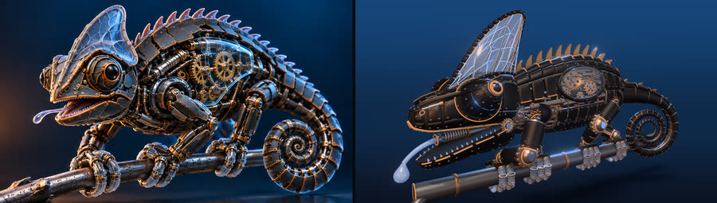
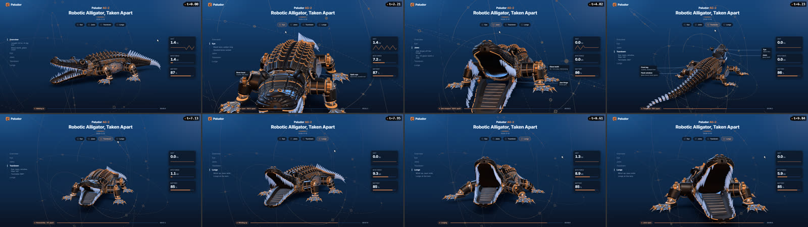
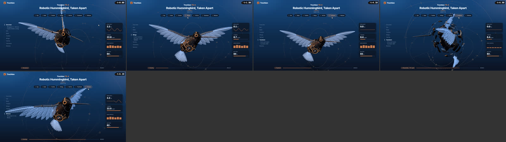

# Blueprint: the full guide

From an empty machine to a 10-second film you can post. Every step here comes from the four builds in this repo (great white, hummingbird, alligator, chameleon) and from the mistakes made on the way.

**The whole loop:**

1. Make a reference sheet in ChatGPT and split it into panels (about 5 minutes).
2. Claude Code builds the object and renders a still. You compare it with the picture, give one or two rounds of notes.
3. You say yes. Claude Code films the 10-second cut with sound.
4. You check the beat sheet, ask for one fix pass if needed, and post.

---

## 0. Set up once

You need:

- **Claude Code** (`npm install -g @anthropic-ai/claude-code`), signed in.
- **Node.js 20+**, **ffmpeg** on PATH, **Python 3** (standard library only).
- **The skill:**

  ```
  npx skills add Denys01/blueprint -g -a claude-code
  ```

  then once, inside the installed folder (or a clone of this repo):

  ```
  npm install && npx playwright install chromium
  ```

Check: `node -v`, `ffmpeg -version`, `python --version`.

### Windows notes

- **`claude` won't start in PowerShell** ("running scripts is disabled on this system"): run
  `Set-ExecutionPolicy -Scope CurrentUser -ExecutionPolicy RemoteSigned` once, or for this window only
  `Set-ExecutionPolicy -Scope Process -ExecutionPolicy Bypass`. Or start it as `claude.cmd`, or use `cmd`.
- **Keep project paths in Latin letters.** A folder like `blueprint-out\Мураха` can break Python and ffmpeg. If your files already sit in such a folder, tell Claude Code to copy them to `./ant-ref` first.
- **Run ffmpeg from the right folder.** Inside `blueprint-out`, use `shark-10s.mp4`, not `blueprint-out/shark-10s.mp4`.

### Save tokens from the start

- One animal per session: type `/clear` before each new one. A long chat carries everything before it into every call.
- `/model` → Opus with **medium** effort is enough for builds with clear numbers.
- Always start from the closest existing body (table in [SKILL.md](../SKILL.md)). The alligator started from the shark, the chameleon from the alligator: each one cost fewer rounds than the last.

---

## 1. The reference: a sheet, not a picture

One picture leaves Claude guessing the proportions, the back, the parts it can't see. A **reference sheet** shows the same subject from every side, plus close-ups and an exploded view.

The two prompts and the checks are in [REFERENCE_IMAGES.md](REFERENCE_IMAGES.md). Here is what they produced for an ant, first try:



Message 2 splits it into `01_hero.png` … `12_exploded.png`. Always split **this same image**: panels generated one at a time each draw a slightly different animal.

Before you move on, look for:

- **The same animal everywhere.** In this sheet the exploded view shows 8 legs while every other panel shows 6. Tell Claude Code which is right ("the ant has 6 legs, not the 8 in the exploded view").
- **Light mechanism** in the gaps (steel, brass), not black.
- **No text** on the image.

Put the sheet as `<subject>.png` and the panels in `<subject>-ref/` in the project root.

---

## 2. The still

Open Claude Code in the project folder, `/clear`, paste the build prompt from [REFERENCE_IMAGES.md](REFERENCE_IMAGES.md#then-in-claude-code) with your subject and the closest example filled in.

It builds the object, renders one still, makes a strip **picture | still** and stops. Nothing gets filmed before your yes.



### Reading the strip

Go top to bottom and name concrete differences, each with a direction:

| Look at | Typical miss | Note that fixed it |
|---|---|---|
| Pose and camera | Side view from far away; legs as stilts | "crouched low like 01_hero, legs bent, camera lower and closer, ~85% of the width" |
| Head | A thin spike snout, a bulb head on a rod neck | "head flows into the beak as one form"; "a new head, not adapted from the shark's jaws: head 0.20 of length, snout tip ≥0.65 of the width at the eyes" |
| Surfaces | Puffy pillow plates, flat black, sparkle dots | "satin graphite plates with seams and rivets, no sparkle glints" |
| Mechanism | Black and invisible | "steel #8c939b and brass #B08A5A marked keep" |
| Glass | One flat sheet with a grid, or white haze | "separate glass blades with branching veins"; "bloom ≤0.15, threshold ≥1.2" |
| Framing | Wingtip or tail cut off | "whole subject inside the edges, ~80–85% of the width" |

The chameleon after one round of notes from that table:



### Rules that kept the rounds low

- **Numbers beat adjectives.** "Shorter" gets you anything; "the jaw ~20% shorter, mouth open ~25°" gets you that.
- **One pass, then stop.** Put "ONE pass, save -rN, keep the previous code, then stop" in every note. Without it Claude Code will loop and burn tokens.
- **If a pass overshoots, go back.** The alligator's round 4 turned the head into a box. "Restore r3 and change only the eyes" gave the approved round 5.
- **Small fixes ride along with the film.** When only a detail is left (a casque 40% lower, a tighter grip on the branch), write "Yes. Before filming, these small fixes, no new strip" and go straight to the film.
- **Know when to stop.** The hummingbird took 9 rounds; past round 5 each round changed less than it cost. Motion, the teardown and the page hide most of what's left.

Every note you give is added to [JOB_DESCRIPTION.md](JOB_DESCRIPTION.md), so the next build starts with it.

---

## 3. The film

Your "yes" message carries the film spec. The parts that matter most:

```
ONLY the 10-second cut. Beats: [4–5 parts, each with what it does].
Exit: [an action toward the lens], ending on the subject, not an empty frame.
One shot per beat from its own side and distance.
Frame 0 big and clear of the side panels; labels clear of the right-hand cards; no bloom flash.
Render 1600x900 dpr 1.2, score it, export blueprint-out/<subject>-10s.mp4 (1920x1080, 60 fps, H.264).
Page in the night look, an invented name, cards for this subject.
Save beats.png, review once, fix real defects in one pass, then stop and tell me the path.
```

Pick beats that are **different moves**, not the same view four times: an eye that unscrews, a jaw that drops, a glass dome that lifts, a tail that uncoils, a tongue that fires. The chameleon's beats (eye turret, tongue, casque, tail, teardown, strike at the lens) made the strongest cut of the four.

### Reading beats.png

Claude Code saves one tile per beat. Here is the alligator's first cut:



What was wrong, and the note that fixed it:

- **The eye beat didn't show the eye** (camera on the back). → "camera on the side of the head, close, aimed at the eye; the lens rings unscrew toward the camera."
- **Four of eight tiles were the same open mouth from the front.** → "replace the reassembly-from-the-front shot with a beat on the glass flank window; keep only ONE head-on open-mouth shot, the final lunge."
- **The open mouth was empty** (a flat ladder and a black void). → "palate plates, a tongue plate, the hinge mechanism lit by the warm key."
- **A weak teardown, labels under the cards.** → "parts separate clearly in layers like the exploded panel, camera closer; labels clear of the right-hand cards."

And a cut that passed (hummingbird):



Also check: frame 0 (it becomes the thumbnail on X), the last frame (never empty), any white flash during the reassembly.

---

## 4. Finish and post

- **An empty tail at the end?** Trim it without a re-render:

  ```
  ffmpeg -y -i shark-10s.mp4 -t 9.5 -af "afade=t=out:st=9.2:d=0.3" -c:v libx264 -crf 16 -pix_fmt yuv420p -c:a aac -movflags +faststart shark-9s.mp4
  ```

- Post the file **with sound** (`<subject>-10s.mp4`; the `-video` file is silent).
- If your app lets you pick a cover, choose the strongest frame, usually the last.

---

## 5. If something breaks

| Problem | Fix |
|---|---|
| The computer switched off mid-build | Files are on disk. Reopen the terminal in the project, `claude`, `/clear`, paste the prompt again. |
| A still entry won't build (`Expected "}"`) | Usually a comment swallowed the end of a line. Ask Claude Code to run `node sims/build.mjs <entry>` and fix the syntax error only. |
| The glass is white haze | Bloom too strong: strength ≤0.15, threshold ≥1.2. |
| The mechanism is black | The night retint darkened it: mark steel and brass materials `userData.keep = true`. |
| Claude Code keeps looping | Say "ONE pass, then stop" and give numbers. |
| Old frames appear in a new beats.png | Clear `blueprint-out/beats-frames` before rendering beats. |

---

## The four builds, for reference

| Build | Started from | Still rounds | What made the difference |
|---|---|---|---|
| Great white (Carcharo GW-1) | piranha | 2 | Going back to round 1, which read better in motion than the "more accurate" round 2 |
| Hummingbird (Trochion TR-4) | wasp | 9 | One lofted body instead of separate parts; materials and light mattered more than geometry |
| Alligator (Paludor AG-2) | shark | 5 | A reference sheet with orthographic views; reverting an overshoot and changing one thing |
| Chameleon (Chromira CM-1) | alligator | 4 | A sheet split into panels from the same image; small fixes folded into the film pass |

Code for all four is in `sims/`; the cuts are in [`media/`](../media).
